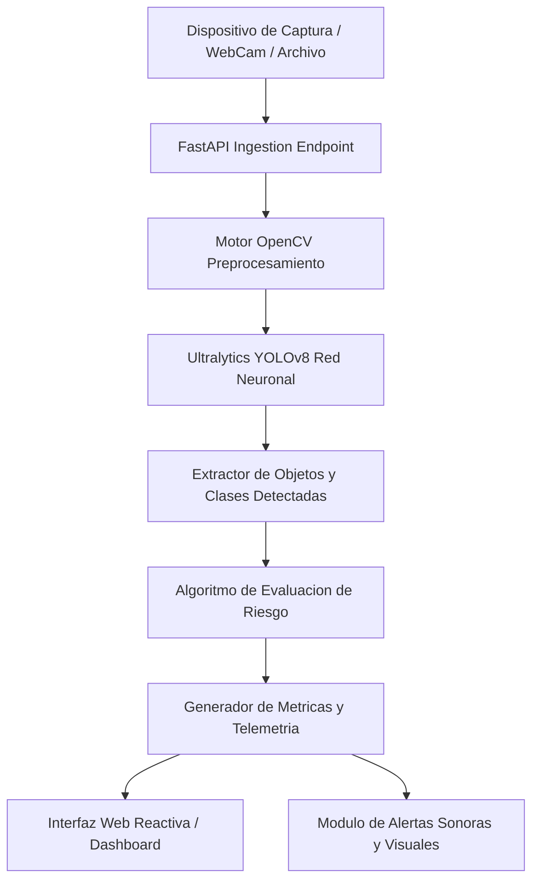

# DriveSafe AI - Sistema Inteligente de Deteccion de Riesgos y Asistencia al Conductor

Solucion integral de vision artificial y telemetria para prevencion de accidentes viales, analisis de distraccion y asistencia predictiva en tiempo real.

[]()
[]()
[]()
[]()

## Resumen Ejecutivo

Los siniestros viales representan una de las principales causas de incidentes evitables a nivel global, vinculados predominantemente a factores humanos como fatiga, distracciones, exceso de velocidad y falta de visibilidad en entornos criticos. DriveSafe AI surge como una respuesta tecnologica de alto impacto disenada para monitorear, evaluar y alertar de manera no intrusiva al operador vehicular mediante tecnicas modernas de vision por computador y procesamiento de transmisiones de video en borde.

## Alcance y Objetivos de Negocio

- Monitoreo continuo de elementos perimetrales (vehiculos, peatones, ciclistas, senales viales).
- Estimacion dinamica de distancias y velocidades relativas de aproximacion.
- Clasificacion automatizada de nivel de riesgo en cuatro niveles (Bajo, Medio, Alto, Critico).
- Despacho inmediato de alertas audiovisuales mediante interfaz web reactiva.
- Capacidad de operacion tanto en entornos reales mediante transmision de camara como en modo de simulacion estocastica para pruebas de homologacion.

## Arquitectura del Sistema

DriveSafe AI implementa una arquitectura modular de tres capas:
1. Capa de Adquisicion e Inferencia (FastAPI, OpenCV, Ultralytics YOLOv8).
2. Capa de Logica de Negocio y Clasificacion de Riesgo (Motor de evaluacion parametrico).
3. Capa de Presentacion y Notificacion (Cliente web reactivo basado en JavaScript vanilla, HTML5 y CSS3).

### Diagrama de Flujo Arquitectonico



### Estructura de Directorios

```text
Hackaton/
├── app.js               # Logica de renderizado del frontend, graficos y polling
├── index.html           # Interfaz de usuario del centro de control y monitoreo
├── main.py              # Servidor FastAPI, endpoints REST y pipeline de inferencia
├── requirements.txt     # Dependencias del ecosistema Python
├── styles.css           # Diseno visual, variables CSS y estilos adaptativos
└── yolov8n.pt           # Pesos del modelo de deep learning preentrenado YOLOv8 Nano
```

## Stack Tecnologico

El proyecto ha sido construido utilizando estandares modernos de ingenieria de software, asegurando compatibilidad multiplataforma y latencia minima de procesamiento.

### Backend e Inteligencia Artificial

-  Lenguaje de programacion principal para el pipeline de datos e inferencia.
-  Framework asincrono de alto desempeno para la exposicion de servicios REST.
-  Procesamiento digital de imagenes y transformacion de matrices de pixeles.
-  Operaciones tensoriales optimizadas y manipulacion matematica de bounding boxes.
-  Servidor ASGI de nivel de produccion para ejecucion asincrona.

### Frontend y Visualizacion

-  Gestion asincrona del estado de la aplicacion y reproduccion de audio.
-  Estructura semantica accesible para paneles de telemetria vehicular.
-  Estilos modulares con soporte de paleta de alerta basada en codigos de color vial.

### Integraciones y Servicios de Machine Learning

- **Ultralytics YOLOv8n**: Red neuronal convolucional optimizada para deteccion de objetos a alta tasa de cuadros por segundo (FPS).
- **Web Audio API**: Generacion sintetizada de frecuencias de advertencia segun severidad de alerta sin requerir librerias binarias pesadas.

## Requisitos Previos del Sistema

- Sistema Operativo: Linux (Ubuntu 20.04+), macOS 12+ o Windows 10/11.
- Python: Version 3.10 o superior (recomendado Python 3.11).
- Memoria RAM: Minimo 4 GB (recomendado 8 GB para inferencia en CPU sin sobrecarga).
- Dispositivo de captura: Camara web integrada o entrada de video USB (opcional en modo simulacion).
- Navegador Web: Google Chrome, Mozilla Firefox o Microsoft Edge con soporte de WebSockets y Canvas.

### Variables de Entorno y Configuracion

| Variable | Tipo | Valor por Defecto | Descripcion |
| :--- | :--- | :--- | :--- |
| `HOST` | String | `0.0.0.0` | Direccion de escucha del servidor ASGI |
| `PORT` | Entero | `8000` | Puerto de enlace para conexiones entrantes |
| `SIMULATION_MODE` | Booleano | `True` | Alterna entre escenarios generados y captura fisica en vivo |
| `CONFIDENCE_THRESHOLD` | Flotante | `0.50` | Umbral minimo de certeza estadistica para aceptar una deteccion |
