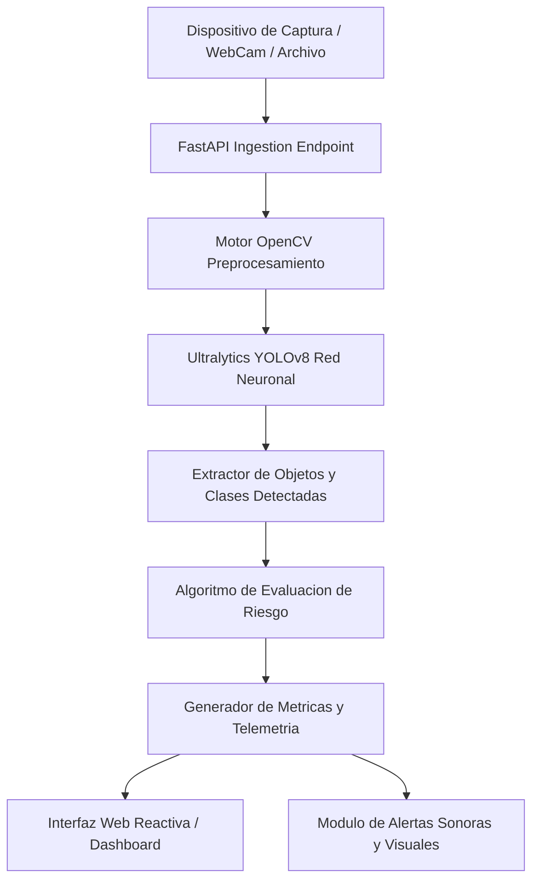

# DriveSafe AI - Sistema Inteligente de Deteccion de Riesgos y Asistencia al Conductor

Solucion integral de vision artificial y telemetria para prevencion de accidentes viales, analisis de distraccion y asistencia predictiva en tiempo real.

## Resumen Ejecutivo

Los siniestros viales representan una de las principales causas de incidentes evitables a nivel global, vinculados predominantemente a factores humanos como fatiga, distracciones, exceso de velocidad y falta de visibilidad en entornos criticos. DriveSafe AI surge como una respuesta tecnologica de alto impacto disenada para monitorear, evaluar y alertar de manera no intrusiva al operador vehicular mediante tecnicas modernas de vision por computador y procesamiento de transmisiones de video en borde.

## Alcance y Objetivos de Negocio

- Monitoreo continuo de elementos perimetrales (vehiculos, peatones, ciclistas, senales viales).
- Estimacion dinamica de distancias y velocidades relativas de aproximacion.
- Clasificacion automatizada de nivel de riesgo en cuatro niveles (Bajo, Medio, Alto, Critico).
- Despacho inmediato de alertas audiovisuales mediante interfaz web reactiva.
- Capacidad de operacion tanto en entornos reales mediante transmision de camara como en modo de simulacion estocastica para pruebas de homologacion.

## Arquitectura del Sistema

DriveSafe AI implementa una arquitectura modular de tres capas:
1. Capa de Adquisicion e Inferencia (FastAPI, OpenCV, Ultralytics YOLOv8).
2. Capa de Logica de Negocio y Clasificacion de Riesgo (Motor de evaluacion parametrico).
3. Capa de Presentacion y Notificacion (Cliente web reactivo basado en JavaScript vanilla, HTML5 y CSS3).

### Diagrama de Flujo Arquitectonico

